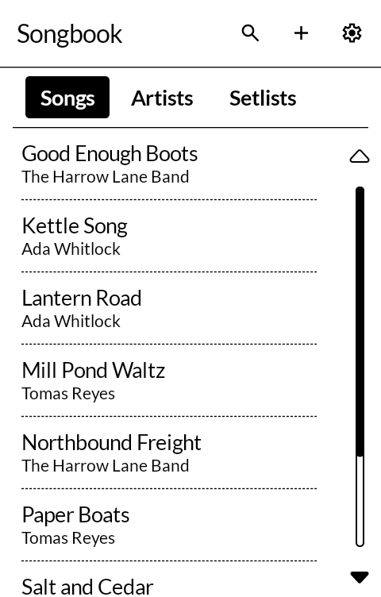
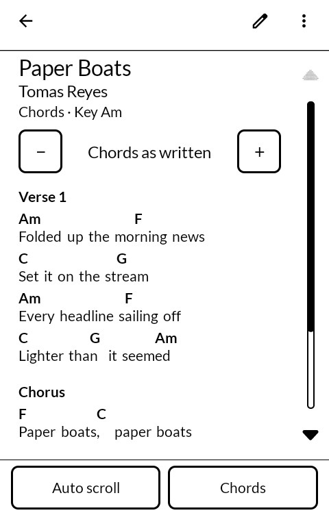
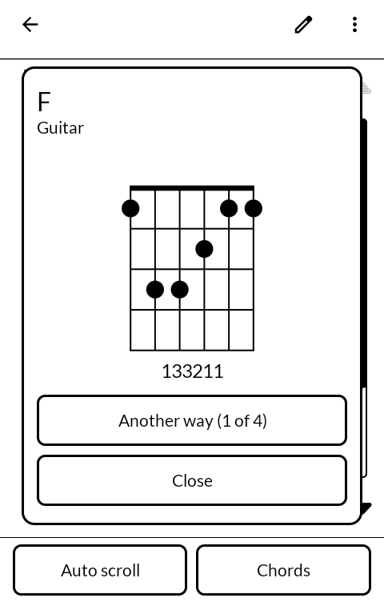
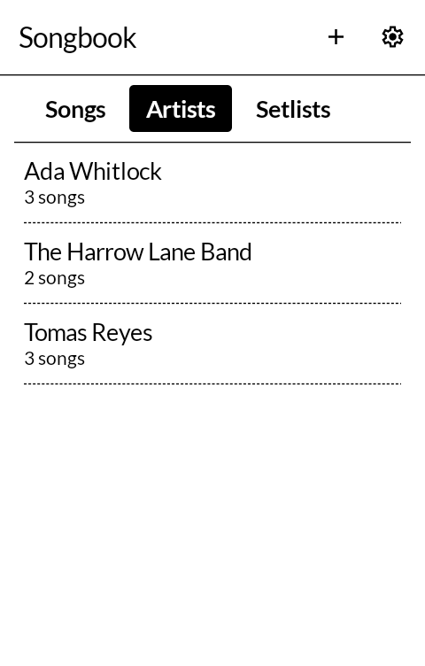

# 歌本 utahon — Songbook

A songbook for the [Mudita Kompakt](https://mudita.com/products/kompakt/): chords, words and
tablature saved from the pages they were found on or typed in by hand, kept on the phone, and
played from without a connection. Built with Mudita's [MMD](https://github.com/mudita/MMD)
design system. It installs on any device with Android 11 or later.

*Utahon* is 歌本, a book of songs.

| | |
|---|---|
|  |  |
|  |  |

## What it does

- **Saves a song from its page.** Share a song's page to Songbook from the browser (or press +
  and paste its address) and it keeps the sheet: the title, who it is by, the capo and tuning
  where the page gives them, and the chords over the words. It reads the sheet a chord site's
  page carries as data, or failing that a block of preformatted text with chords in it, which
  is how most chord sites set a sheet. A page with neither opens
  the form with its name and address filled in, for the sheet to be pasted. Several addresses
  pasted or shared at once are read one after another, and a list says what became of each.
- **Typed or pasted in by hand.** Chords go on a line of their own over the words they belong
  to, the way sheets are written everywhere. A line in square brackets, such as `[Chorus]`,
  names a part. Rows of tablature are kept as they are. Text shared from another app becomes a
  draft. A sheet written as ChordPro (chords in brackets inside the words) can be pasted or
  shared as it is, and is kept as chords over words like every other.
- **The sheet reads like a page.** The words are set in the phone's own type and wrap as a
  sentence does; every chord stays over its syllable. Tablature is set in a typewriter face, and
  a system too wide for the screen is cut into pieces, every string at the same place.
- **Press a chord to see it.** A chord box shows where the fingers go, with other ways to play
  it where there are any, for guitar, ukulele or mandolin (Settings). The common guitar chords
  are the shapes a chord chart prints; the rest are worked out from the notes of the chord.
  A sheet that says it is for the ukulele or the mandolin gets that instrument's boxes.
- **Chords in this song** lists every chord the song uses, with its box.
- **Transpose.** The − and + under the title move every chord a semitone, the ones named in a
  sentence ("Repeat C and G") with the rest, and the song stays where you left it. Flats or sharps are chosen to suit the key it lands in.
- **Auto scroll** moves the sheet on a line at a time, so the lines being played stay in view
  while the next arrive. The − and + set its speed, 1 to 9, and each song remembers its own;
  give a song its length and it picks the speed that ends with the song. Nothing glides: the
  panel repaints once per line.
- **A pedal turns the page.** A Bluetooth page-turn pedal is a keyboard with two keys; Page
  Down, Page Up, the arrows and the space bar move an open sheet a third of a page.
- **Sideways for wide tablature.** Turn the phone and an open song turns with it (a setting);
  the top bar gives its room to the sheet until the phone is upright again.
- **A folder for each artist.** The Artists tab keeps the songs by who they are by, with no
  filing to do: a song's artist is its folder.
- **Setlists.** Songs in the order they are played, on the third tab. A song opened from a
  setlist ends with the way on to the next one.
- **The screen stays on** while a song is open (a setting), since both hands are busy.
- **Tuner** opens from a song's ⋮, and from the tuning line of a song in a tuning of its own,
  when [Tuner](https://github.com/wanderwildwood/onsa) is on the phone.
- **Search** over titles, artists and words.
- **In and out of a file.** Settings saves every song, with the setlists, to one file, and
  brings in a saved songbook, a ChordPro file (`.cho`, `.pro`, `.crd`) or a plain sheet of
  chords over words. A single song can be saved as a ChordPro file, which most songbook
  programs read, or sent as text; both in the key it is shown in.

- **Sync with your own Nextcloud**, if you sign in to one (Settings → Nextcloud). Each song is
  one ChordPro file there, in a folder for its artist, so the songs are on any other device signed in to it and
  open in other songbook programs, and a song put in the folder by hand comes here. It is off
  until you sign in, and the app works the same without it.

## Nextcloud

Signing in is typed: the server's address, your login name and an app password made in Nextcloud
(Personal settings, Security, Devices and sessions), which can be revoked there without touching
your real one. "Sign in with the browser instead" goes through Nextcloud's own login page, as
its apps do, for a server that asks for more at its door. The folder starts as `Songbook` and
can be changed.

A song is one file, named for its title, in a folder named for its artist
(`Ada Whitlock/Lantern Road.cho`); a song that names no artist sits beside the folders. Give a
song another artist and its file moves; a file put into an artist's folder by hand, with no
artist written in it, is taken to be by that artist. It syncs
when the app is opened, a few seconds after a song is saved, set or deleted, when you press Sync
now, and when the song list is pulled down from its top (a line above it says "Syncing…", then
"Up to date"). Each side's changes since the last sync are followed:

- changed on one side: the other side takes the change;
- changed on both: both are kept, the server's under the song's title and the phone's as
  "… (phone)" beside it, unless the two now say the same thing;
- deleted on one side and not changed on the other: deleted on both. A change beats a deletion.

The file is ordinary ChordPro. What ChordPro has no word for (the tuning, where the sheet came
from, how far you have moved it, its speed and length) is kept in lines named `x_songbook_…`,
which other programs pass over. A sheet that comes back from the server has its spacing evened
out: chords stay over their syllables, but a line of chords alone comes back two spaces apart.

The setlists are kept beside the songs in one file, `Setlists.json`. Changed on one side, the
other takes them; changed on both, the two are put together, and a list both sides changed is
kept twice, the phone's as "… (phone)".

## The file

A song is kept as plain text with a few facts beside it (title, artist, capo, tuning, where it
came from, how far it has been moved, its scroll speed, its length): one small JSON file each in
the app's own storage. A saved songbook is one JSON document holding them all and the setlists;
bringing it back replaces the songs it holds and adds the rest.

## What it does not do

- **No account of its own.** The only sync is with a Nextcloud of your own, and only once you
  sign in to it.
- **No search of the web.** You find the song in your browser and share its page.
- **No Guitar Pro or "official" tabs.** Those pages carry no sheet as text.
- **No sound.** It does not play the song or the chord.
- ChordPro is read for its chords, words, parts and tablature; its fonts, colors, grids and
  page layout are not.
- A chord named in a sentence is taken for one only when the line is plainly about playing: a
  lone capital letter among ordinary words is left a word.
- The chord boxes for chords outside the chart are worked out, not looked up, and are sometimes
  not the shape a teacher would pick. "Another way" shows the others.

## Privacy

Songbook goes online for two things. One is to fetch a song's page whose address you shared with
it or typed in. That page is fetched once, saying plainly that it is Songbook, and nothing else
is sent: no pictures are fetched, no scripts run, nothing about you or your songs goes with the
request. A site that refuses is not got round; the app says so and the sheet can be pasted in.

The other is Nextcloud, and only when you have signed in to one: then your songs go to your own
Nextcloud, and to nowhere else. Nothing goes there before you sign in, and after you sign out
nothing more does; the songs already there stay until you delete them there.

Everything else stays on the phone, in the app's own storage. There are no accounts of the
app's own, no analytics and no adverts. The app does not back itself up; uninstalling it removes everything,
so save your songs to a file first if you want them. [PRIVACY.md](PRIVACY.md) has the same,
with the permissions.

A song's page is saved for your own use. The song stays its writers', and the sheet whoever
wrote it out.

## Building

```
./gradlew assembleDebug
```

A release build needs a keystore at `signing/signing.keystore` with a matching
`signing/signing.properties`. There is no fallback key in this repository: without one, a
release build comes out unsigned rather than wrongly signed.

`./gradlew testDebugUnitTest` runs the tests: chord names read, moved and turned into notes;
fingerings checked note by note on each instrument; sheets read into their kinds of line and
written out again; ChordPro read and written; the page reader against made-up pages in the
shapes the real ones have; and for Nextcloud, songs written to and read from their files, two-way
sync against a made-up server held in memory (new on either side, edits on one side or both,
deletions, a change against a deletion, renames, a file changed under a sync as it writes), the
setlists put together from two sides, and
the WebDAV calls and a whole sync over real HTTP against a small server inside the test.

## Getting it, and keeping it

Download <https://github.com/wanderwildwood/utahon/releases/latest/download/utahon.apk>
and sideload it. That address always points at the newest release, and every release
publishes a `.sha256` beside the APK if you would rather check than trust.

For updates without doing this by hand, add this repository to
[Obtainium](https://github.com/ImranR98/Obtainium):

    https://github.com/wanderwildwood/utahon

## License

GPL-3.0-only. See [LICENSE](LICENSE).

Copyright (C) 2026 wander wildwood

This program is free software: you can redistribute it and/or modify it under the terms of the
GNU General Public License as published by the Free Software Foundation, version 3.

This program is distributed in the hope that it will be useful, but WITHOUT ANY WARRANTY;
without even the implied warranty of MERCHANTABILITY or FITNESS FOR A PARTICULAR PURPOSE. See
the GNU General Public License for more details.

You should have received a copy of the GNU General Public License along with this program. If
not, see <https://www.gnu.org/licenses/>.

Icons are from Material Symbols, Apache 2.0.
